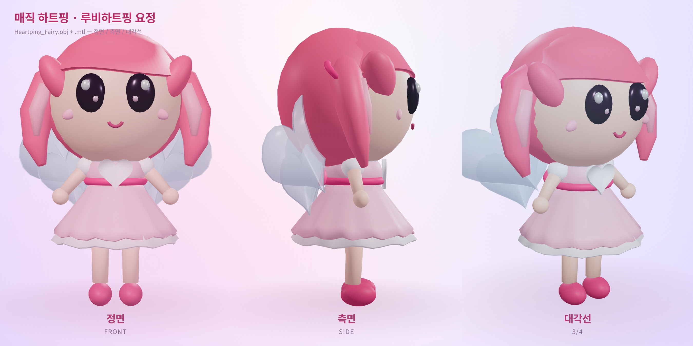
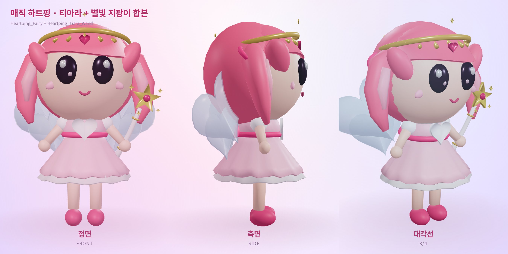

# 🧚 매직 하트핑 3D 모델 — 블렌더 5.3.0 · 로블록스 스튜디오용

「매직 하트핑」의 주인공 **루비하트핑 요정**을 3D 모델 파일(`.obj` + `.mtl`)로 만들었습니다.
블렌더를 켜서 이 파일을 열면 바로 **큰 머리 2등신 치비 요정**(분홍 머리 · 늘어진 요정 귀 · 눈·볼터치·입 · 프릴 원피스 · 하트 날개)이 나오고,
따로 들어 있는 **황금 티아라 + 별빛 마법 지팡이**를 합치면 원래 그림과 똑같은 모습이 됩니다.

- 처음부터 깎을 필요 없이 **색만 바꾸거나 파츠를 움직여** 쓰시면 됩니다.
- 로블록스 MeshPart 제한(**삼각형 10,000개**)을 넘지 않게 만들었습니다 — 요정 **9,792개** / 티아라+지팡이 **2,036개**.

---

## 0. 파일 목록

| 파일 | 설명 | 삼각형 |
|---|---|---|
| `Heartping_Fairy.obj` + `.mtl` | 루비하트핑 요정 본체 (44개 파츠) | **9,792** |
| `Heartping_Tiara_Wand.obj` + `.mtl` | 황금 티아라 + 별빛 마법 지팡이 (23개 파츠) | **2,036** |
| `preview-heartping-3d.png` | 요정 3D 미리보기 (정면·측면·대각선) | — |
| `preview-heartping-accessories-3d.png` | 티아라·지팡이 미리보기 | — |
| `preview-heartping-combined-3d.png` | 요정 + 티아라 + 지팡이 **합본** 미리보기 | — |
| `viewer.html` | 브라우저에서 3D로 돌려 보는 뷰어 (폰에서도 됨) | — |
| `tools/generate_heartping.py` | 이 모델을 다시 뽑는 파이썬 스크립트 | — |

**미리보기 (실제 `.obj`+`.mtl` 파일을 3D로 불러와 렌더링한 것)**




**브라우저에서 직접 돌려 보기** (손가락으로 돌리고 확대 가능):
`https://8n9wtwzdf6-web.github.io/pickle-mini-games/roblox-fairy-catch/models/viewer.html`

---

## 1. 블렌더 5.3.0에서 열기

> `.obj` 와 `.mtl` 은 **꼭 같은 폴더에** 두세요. `.mtl` 이 없으면 색이 하나도 안 나옵니다.

1. 다운로드한 `Heartping_Fairy.obj`, `Heartping_Fairy.mtl` 두 파일을 **한 폴더**(예: 바탕화면 `하트핑` 폴더)에 넣습니다.
2. 블렌더를 실행하고, 처음 뜨는 시작 화면은 오른쪽 위 **X** 를 눌러 닫습니다(또는 빈 곳을 클릭).
3. 위쪽 메뉴에서 **`파일(File)` → `가져오기(Import)` → `Wavefront (.obj)`** 를 누릅니다.
4. 파일 선택 창이 열리면 아까 그 폴더로 가서 **`Heartping_Fairy.obj`** 를 클릭하고 오른쪽 아래 **`Wavefront (.obj) 가져오기`** 버튼을 누릅니다.
   - 오른쪽 설정 패널은 **그대로 두시면 됩니다** (`Up Axis: Y`, `Forward Axis: -Z` 가 기본값이고, 이 파일이 딱 그 규칙으로 만들어졌습니다).
5. **숫자패드 `1`** 을 누르면 정면에서 얼굴이 보입니다.
   - 노트북이라 숫자패드가 없으면: **`보기(View)` → `시점(Viewpoint)` → `정면(Front)`**.
   - 혹시 **뒤통수가 보이면** 방향만 반대로 들어온 것이니, `A`(전체 선택) → `R` → `180` → `Enter` 로 한 번에 돌려 주세요. (블렌더 버전에 따라 기본 축 설정이 조금 다를 수 있습니다)
6. 화면 오른쪽 위 **아웃라이너(Outliner)** 를 보면 `Head`, `Hair_Back`, `Hair_Bangs`, `Eye_L`, `Skirt`, `Wing_Upper_L` … 처럼 **파츠가 하나씩** 들어 있습니다. 클릭하면 그 파츠만 선택됩니다.

### 색 바꾸는 법 (파츠별)

1. 아웃라이너에서 파츠(예: `Skirt`)를 클릭합니다.
2. 오른쪽 아래 **재질 속성(Material Properties)** 탭(빨간색 동그라미 아이콘)을 엽니다.
3. **`기본 색상(Base Color)`** 의 색 네모를 눌러 원하는 색을 고르면 그 파츠만 색이 바뀝니다.
   - 같은 재질(`Dress`, `Hair` …)을 쓰는 파츠가 여럿이면 함께 바뀝니다. 따로 바꾸려면 재질을 복제(`재질 → 복사`)하세요.
4. 저장: **`파일` → `저장`**(`Ctrl + S`) → `.blend` 파일로 저장됩니다. (다음부터는 `.blend` 를 열면 됩니다.)

### 파츠 옮기기 / 크기

- 파츠 클릭 → `G`(이동) / `S`(크기) / `R`(회전) → 마우스 움직이고 클릭해서 확정.
- 실수했으면 `Ctrl + Z`.

---

## 2. 로블록스 스튜디오에 넣기

1. 로블록스 스튜디오를 켜고 새 Baseplate를 엽니다.
2. 위쪽 메뉴 **`파일(File)` → `Import 3D`** (또는 `홈`·`Avatar` 탭의 **`Import 3D`**, 단축키 `Ctrl + M`).
3. **`파일 선택`** → `Heartping_Fairy.obj` 를 고릅니다. (`.mtl` 은 같은 폴더에 있으면 자동으로 함께 읽습니다.)
4. 미리보기 오른쪽 설정에서 **`Scale Unit` 을 `Meter` 로 바꿉니다.** ⚠️ 기본값 `Studs` 로 두면 실제보다 **약 3.6배 크게** 들어옵니다.
5. `File Geometry` 에 **Polygon count 9,792** 가 보이는지 확인합니다 (10,000 이하라 통과).
6. **`Import`** → 워크스페이스에 **MeshPart** 로 들어옵니다. (Move 도구로 원하는 위치에 놓기)
7. **방향**: 이 모델은 **+Z 쪽을 바라봅니다.** 로블록스 캐릭터의 정면은 **-Z** 라서, 뒤통수를 보이면 **Rotate 도구로 180°** 돌려 주세요.
8. **색**: `.obj` 는 로블록스로 **재질 색이 넘어가지 않습니다**(회색으로 들어옵니다). 두 가지 방법 중 편한 쪽으로:
   - **간단하게**: MeshPart 를 선택 → 속성(Properties) → **`Color`** 를 분홍으로 지정. (모델 전체가 한 색)
   - **파츠별로 색을 살리려면**: 블렌더에서 파츠를 클릭 → `파일 → 내보내기 → Wavefront (.obj)` 에서 **`Selected Only`** 를 체크해 파츠마다 따로 저장 → 스튜디오에서 하나씩 Import. (색이 다른 조각을 각각 MeshPart 로 넣는 방식)
9. **날개 투명도**: 한 파일이 한 MeshPart 로 들어오기 때문에 `Transparency` 를 주면 몸 전체가 투명해집니다. 날개만 투명하게 하려면 블렌더에서 날개 4개만 따로 내보내 별도 MeshPart 로 넣고 그 부분만 Transparency 를 주세요.
10. 게임에 배치할 때는 MeshPart 속성에서 **`Anchored`** 를 체크하면 떨어지지 않습니다.

---

## 3. 티아라 + 별빛 지팡이 (합본)

- `Heartping_Tiara_Wand.obj` 는 **요정과 똑같은 좌표계**로 만들어서, 두 파일을 그대로 같이 불러오면 **머리 위에 티아라가, 오른손에 지팡이가** 정확히 겹칩니다. (`preview-heartping-combined-3d.png` 참고)
- 티아라만, 지팡이만 따로 쓰고 싶으면 블렌더에서 필요 없는 파츠(`Wand_*` 또는 `Tiara_*`)를 지우고 저장하면 됩니다.
- 파츠 이름: `Tiara_Band`, `Tiara_Spike_1~5`, `Tiara_Gem_Heart`, `Tiara_Gem_Cyan_L/R`, `Tiara_Spark_*`, `Wand_Handle`, `Wand_Ring_1~2`, `Wand_Star`, `Wand_Star_Gem`, `Wand_Spark_*`.

---

## 4. 모델을 다시 뽑고 싶을 때 (파이썬)

`tools/` 폴더에서 (파이썬 3 + numpy 필요):

```bash
python3 generate_heartping.py out
```

`out/` 폴더에 `.obj`·`.mtl` 두 쌍이 다시 만들어집니다. 숫자(반지름, 파츠 위치, 색)는 `generate_heartping.py` 안에서 바로 고칠 수 있습니다.

---

## 5. 모델 사양 (참고)

| 항목 | 값 |
|---|---|
| 단위 | 1 unit = 1 m (블렌더 기본) |
| 키 | 약 2.11 m (발바닥 0) |
| 좌표계 | 표준 OBJ — **Y축이 위**, 얼굴은 **+Z** |
| 파츠 수 | 요정 44개 / 티아라·지팡이 23개 |
| 삼각형 | 9,792 / 2,036 (로블록스 MeshPart 한도 10,000 이하) |
| 재질(색) | Skin 살구 · Hair 분홍 · HairLight 연분홍 · Dress 연분홍 원피스 · DressTrim 흰 프릴 · Ribbon 진분홍 · Shoes 분홍 구두 · Eye 짙은 자주 · EyeShine 흰 하이라이트 · Blush 볼터치 · Mouth 입 · Wing 반투명 하늘빛 · Gold 금 · StarGold 별빛 금 · GemPink 분홍 보석 · GemCyan 하늘 보석 · Pearl 진주 |

요정 파츠 이름: `Head`, `Neck`, `Hair_Back`, `Hair_Bangs`, `Hair_Side_L/R`, `Hair_Ear_L/R`, `Hair_EarInner_L/R`, `Hair_EarTie_L/R`, `Eye_L/R`, `EyeShine_L/R`, `EyeShineLow_L/R`, `Cheek_L/R`, `Mouth`, `Body_Bodice`, `Collar_Frill`, `Puff_Sleeve_L/R`, `Chest_Heart`, `Skirt`, `Skirt_Frill`, `Waist_Ribbon`, `Back_Bow_Knot`, `Back_Bow_L/R`, `Arm_L/R`, `Hand_L/R`, `Leg_L/R`, `Shoe_L/R`, `Wing_Upper_L/R`, `Wing_Lower_L/R`.

> 이 모델은 「매직 하트핑」용으로 새로 만든 **오리지널 캐릭터**입니다. 다른 작품의 캐릭터를 베끼지 않았으니 로블록스에 올려도 저작권 문제가 없습니다.
