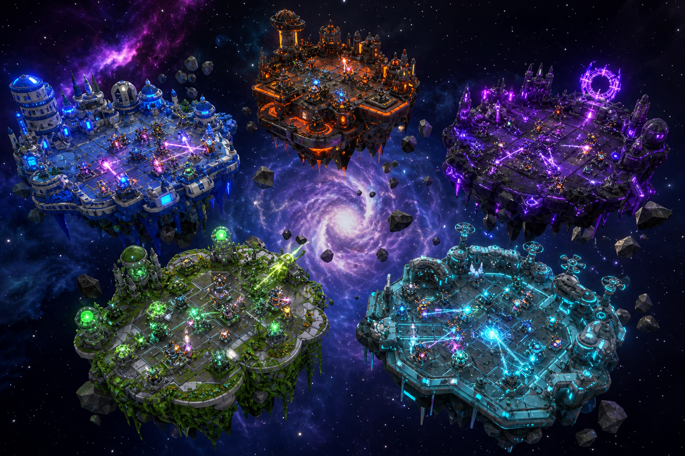
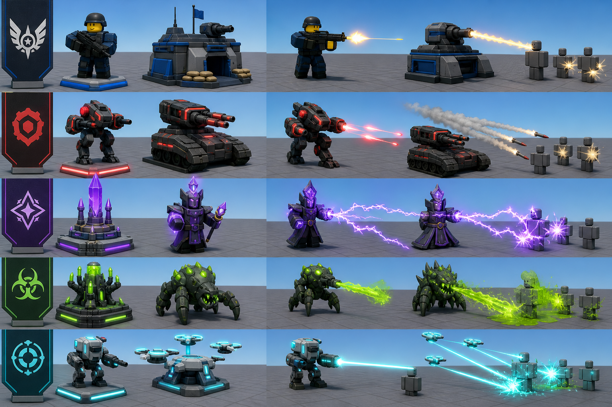
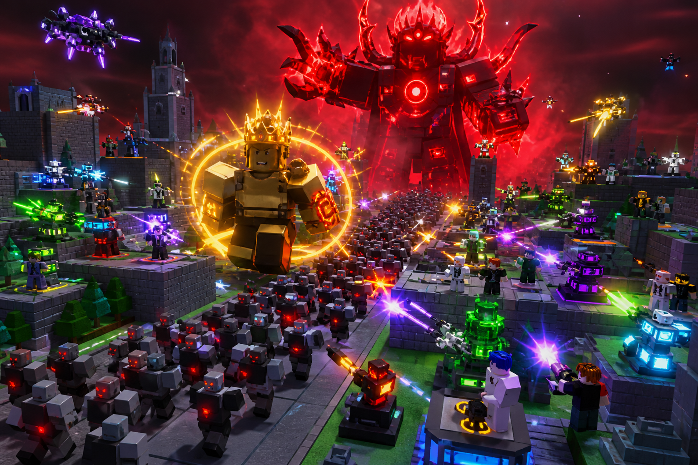
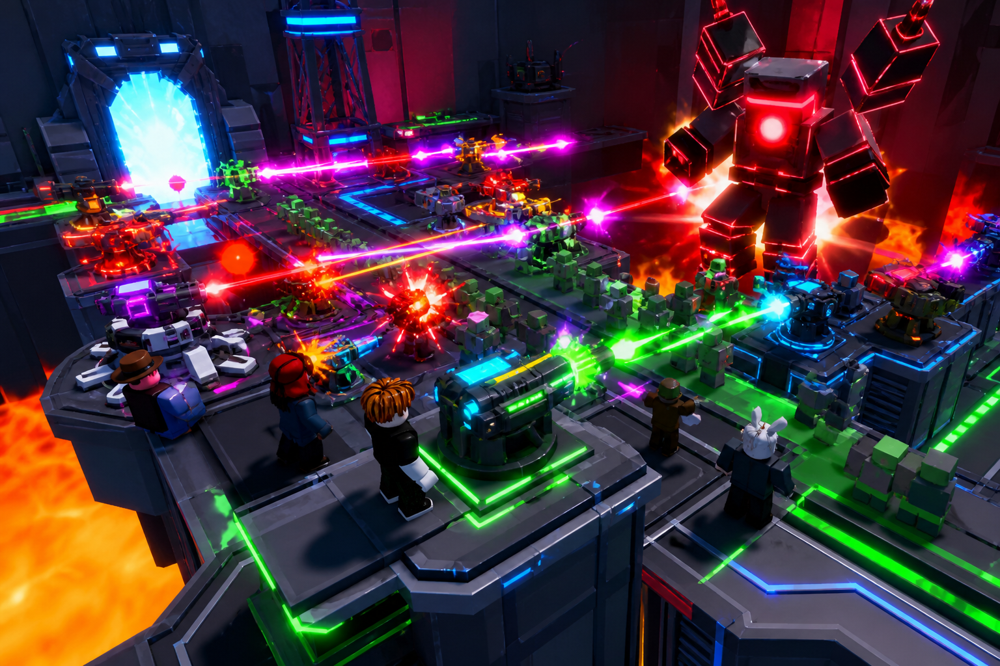

# 🚀 터렛 디펜스: 우주 5섬 — 최종 통합 기획·구현 명세서 (SPEC_V3)

> **버전** 3.0 (확정) · **작성일** 2026-11-27 · **대상** 로블록스(Roblox) PC·모바일
> **읽는 사람** 노트북의 AI 에이전트 **Hermes**, 그리고 개발자(재권 님)
> **저장소** `8n9wtwzdf6-web/pickle-mini-games` · **경로** `roblox-turret-defense/`
> **상태** 기획 확정 — 이 문서대로 새로 코딩하거나 기존 v3 코드를 개선하면 됩니다.
> **최근 추가** 2026-11-27 · 재권 님이 Studio에서 직접 플레이해 확인 → **8.5절(시안 이미지 19장)** · **8.6절(필수 비주얼 보완 3가지)** 추가

> ### 🔴 지금 최우선 (2026-11-27 Studio 확인)
> 재권 님이 Studio에서 플레이해 본 결과 **"시안과 전혀 다릅니다."** 원인은 3가지입니다.
> ① 하늘이 **밝은 파란 낮**이고 섬 아래로 하늘이 비쳐 우주가 아님 → **검은 우주 Skybox · 성운 · Bloom 네온 발광**
> ② 5섬이 **바위 절벽도 네온 테두리도 없는 밋밋한 검은 네모 판** → **다각형 부유섬 + 종족별 발광 네온 테두리**
> ③ `models/*.obj` **18종이 Studio에 안 얹힘**(본진·터렛이 작은 블록) → **`MeshPart` 실제 적용**
>
> **→ 코딩을 시작하기 전에 8.5절(시안 이미지)과 8.6절(보완 3가지)을 먼저 읽으세요.**

---

## 0. 이 문서를 쓰는 법 (Hermes 필독)

1. 이 문서는 **"무엇을 만들지"의 최종 기준**입니다. 오늘(2026-11-27) 재권 님이 대화에서 확정한 내용을 한 파일에 모았습니다.
2. **"어떻게 되어 있는지"의 기준**은 코드입니다. 특히 수치의 단일 원천은 `ReplicatedStorage/TDShared.lua` 입니다(종족·모드·융합·확률·가격·스테이지·보스).
3. 문서와 코드의 수치가 다르면:
   - **기획 의도**는 이 문서를 따르고,
   - **세부 밸런스 수치**는 `TDShared.lua`의 현재 값을 기준으로 삼되,
   - 바꾼 값과 이유를 작업 보고(PR 설명)에 반드시 적으세요.
4. 이 문서에 없는 기능을 "더 좋을 것 같아서" 임의로 추가하지 마세요. 추가 제안은 코드가 아니라 **보고서의 제안 항목**으로 분리하세요.
5. 절대 금지 사항은 **10장**, 완료 판정 기준은 **11장**에 있습니다. 코딩 전에 두 장을 먼저 읽으세요.
6. **목표 화면의 기준은 `concepts/`의 시안 19장(8.5절)**이고, **지금 코드가 시안과 다른 이유 3가지는 8.6절**에 있습니다. 이번 작업의 성공 판정은 "기능이 도는가"가 아니라 **"시안과 같은 화면인가"**입니다.

### 한 줄 소개

> 깊은 우주에 **5개 종족의 부유 섬**이 정오각형으로 떠 있고, 각 팀은 **자유 전략 건설 그리드**에 터렛을 세워 **40단계 × 100마리**를 막고, 마지막에는 **우주 정중앙의 오메가 파괴신**에게 5팀이 동시에 화력을 퍼부으며 **실시간 딜량 1~5위**를 다툰다.

**장르**: 랜덤 타워 디펜스(RTD) × 자유 배치 미로 디펜스 × 머지 진화 × 이종족 융합 × 5팀 경쟁 레이드

---

## 1. 프로젝트 개요 & 목표

### 1.1 왜 만드는가

- 재권 님의 목표는 **AI로 만든 로블록스 게임을 실제로 게시해 수익을 내는 것**입니다. 취미용 프로토타입이 아니라 **수익화·리텐션·재방문**이 처음부터 설계에 들어가야 합니다.
- 따라서 이 게임은 "예쁜 데모"가 아니라 **① 첫 5분에 재미가 보이고 ② 다시 접속할 이유가 있고 ③ 경쟁심으로 소액 결제가 나오는** 구조를 목표로 합니다.

### 1.2 무엇을 만드는가

| 항목 | 내용 |
|---|---|
| 플랫폼 | Roblox (PC + 모바일 가로/세로 대응) |
| 1판 인원 | 사람 1명 + **AI 4팀** = 5팀 경쟁 (현재 구현) |
| 1판 길이 | 40단계 8~12분 + 최종 보스 25~40초 |
| 핵심 루프 | 테마·종족 선택 → 뽑기 → 타일 건설 → 합성/모드전환 → 40단계 방어 → 중앙 보스 레이드 → 보상 → 재도전 |
| 수익 모델 | 게임패스 6종 + 개발자 상품 11종 + 보석 번들 |
| 웹 테스트판 | `turret-defense/` (아이폰 사파리, GitHub Pages) — 로블록스 게시 전 감각 확인용 |

### 1.3 성공 기준 (출시 판정)

- [ ] 로블록스 Studio에서 **오류 0건**으로 40단계 + 최종 보스까지 완주된다.
- [ ] 신규 유저가 **첫 60초 안에 터렛을 세우고 첫 몬스터를 잡는다**.
- [ ] 결제 상품 ID를 넣으면 상점에서 실제 구매가 되고, **재접속해도 보유 아이템·재화가 유지**된다.
- [ ] 모바일 세로 화면에서 HUD·건설·상점이 겹치지 않는다.
- [ ] 확률 공개·영수증 검증·서버 권한 등 **로블록스 정책 필수 항목**을 만족한다.
- [ ] 1판 평균 10분, 재접속 시 즉시 새 판을 시작할 수 있다.

### 1.4 하지 않는 것 (Non-goals)

- 4레인 일자 복도 맵 (v2 방식) — **완전 폐기**
- 유저 간 직접 PvP 공격, 아이템 거래, 현금 거래
- 5개 섬을 실제 5명이 각자 조작하는 실시간 매치메이킹 (현재는 AI 4팀)
- 로블록스 밖 결제·외부 링크 유도

---

## 2. 핵심 월드 & 맵 구조

### 2.1 우주 배치

```
                        ┌── Arena 1 · 휴먼 ──┐
            Arena 5     │  (부유 섬 68×68)   │      Arena 2 · 메카
             드론       └──────────┬─────────┘
                 ╲                 │                 ╱
                  ╲        ✦ 우주 정중앙 ✦         ╱
                   ╲   오메가 파괴신 제단 (r=34)   ╱
                  ╱                │                ╲
                 ╱                 │                 ╲
            Arena 4 · 바이오 ───────┴────── Arena 3 · 아케인
```

- 5개 섬은 우주 중심에서 **150 studs** 떨어져 **72° 간격(정오각형)** 으로 떠 있습니다.
- 각 섬의 **로컬 +Z = 우주 중심(넥서스) 방향**, **-Z = 바깥(몬스터 스폰 게이트)** 입니다.
- 섬과 섬 사이는 **진짜로 비어 있는 우주**여야 합니다. 판을 이어 붙이거나 하나의 거대한 바닥으로 만들지 마세요.
- 배경: 별·성운·회전하는 에너지 링·부유 파편. 안개(fog)로 깊이감을 주고, 섬 아래로는 바닥이 보이지 않게 합니다.

### 2.2 수치 (코드 기준)

| 상수 | 값 | 의미 |
|---|---|---|
| `ARENA_RADIUS` | 150 | 우주 중심 → 섬 중심 |
| `PLATE` | 68 | 섬 판 크기(정사각, studs) |
| `GRID_N` | 8 | 전체 건설 그리드 8×8 |
| `FREE_N` | 6 | 기본 사용 가능한 안쪽 6×6 (확장 패스로 8×8) |
| `CELL` | 7 | 타일 한 칸 = 7 studs |
| `NEXUS_LOCAL` | (0, 0, 31) | 섬 안 본진 위치 |
| `SPAWN_LOCAL` | (-3.5, 0, -38) | 몬스터 진입 게이트 |
| `START_CELL` | col 4, row 1 | 몬스터가 들어오는 타일 |
| `GOAL_CELL` | col 5, row 8 | 본진 직전 타일 |
| `CORE_MAX` | 30 | 넥서스 코어 HP |
| `RAID_TIME` | 150 | 최종 보스 레이드 제한(초) |

### 2.3 3종 맵 테마

| 키 | 이름 | 바닥 | 포인트 색 | 분위기 |
|---|---|---|---|---|
| `sf` | 🌌 우주 요새 | 메탈 장갑판(43,56,67) | 시안 네온(84,232,255) | 성운·궤도 링·부유 구조물 |
| `fantasy` | 🏰 판타지 성채 | 석재(64,55,46) | 황금(255,179,71) | 성벽·용암 해자·보라 마법진 |
| `cyber` | 🏙️ 사이버펑크 도시 | 아스팔트(27,31,44) | 마젠타(255,46,151) | 고층 빌딩·고가 도로·홀로그램 |

- 인트로에서 선택하고, 전투 중에도 **🌌 버튼으로 즉시 전환**할 수 있어야 합니다.
- 전환 시 바닥·장식·조명·넥서스 색이 함께 바뀌어야 하며, **전투 상태(몬스터·터렛·HP·자원)는 유지**됩니다.

### 2.4 내 섬의 자유 전략 건설 그리드 (핵심)

**일자 복도 금지.** 이것은 취향이 아니라 이 게임의 정체성입니다.

- 섬 바닥은 **8×8 타일**이고, 플레이어는 **원하는 타일을 직접 탭**해 터렛을 세웁니다.
- 몬스터는 **외곽 게이트(START_CELL)** 에서 들어와 **본진(GOAL_CELL)** 으로 갑니다. 경로는 고정 복도가 아니라 **건설된 터렛을 피해 매번 다시 계산(BFS)** 됩니다.
- 그래서 플레이어는:
  - 길을 길게 돌려 화력을 오래 맞게 하는 **미로 설계**,
  - 게이트 바로 앞에서 녹이는 **입구 컷**,
  - 본진 앞 집중 포화 진형을 만들 수 있습니다.
- **규칙**: 건설 후 스폰→본진 경로가 **완전히 막히면 그 건설을 거부**하고 이유를 표시합니다. "못 지나가게" 만들 수는 없지만 "돌아가게" 만들 수는 있습니다.
- 타일 위에는 터렛 1기. 이동·판매 가능. 등급·종족·모드가 타일 오브젝트에 그대로 보입니다.
- 기본 6×6(36칸) 중 건설 가능 칸 약 20~25칸. **아레나 확장 패스**로 8×8 전체를 엽니다.

### 2.5 시점(Camera)

- **🔭 전체 5섬 보기**: 5개 섬과 중앙 제단이 한 화면에 들어오는 전략 뷰.
- **🎯 내 섬 집중**: 내 그리드가 크게 보이는 건설 뷰.
- 모바일 세로 화면에서 상·하단 HUD에 가리지 않도록 카메라를 보정합니다.
- 보스전에서는 중앙 보스와 5개 섬의 화력 트레이서가 보이도록 자동으로 넓은 뷰를 제안합니다.

---

## 3. 5대 종족 · 2모드 변형 · 전용 스킬

### 3.1 종족 개요

| 종족 | 정체성 | 종족 패시브 | 본진(넥서스) | 모드 A | 모드 B |
|---|---|---|---|---|---|
| 👤 **휴먼** | 밸런스·자원 효율 | 미네랄 +10% · 가스 +10% | 전술 지휘 벙커 | 병력 — 빠른 연사 | 벙커 — 광역 박격포·감속 |
| 🛡️ **메카** | 폭발·단일 폭딜 | 공격력 +15% · 폭발 범위 +25% | 중장갑 요새 | 워커 — 미사일 다연발 | 시즈 — 장거리 포격·충격파 |
| 🔮 **아케인** | 광역·마법 연쇄 | 25% 연쇄 번개 · 광역 +20% | 부유 수정 넥서스 | 타워 — 체인 라이트닝 | 수호자 — 집중 레이저·관통 |
| 🧬 **바이오** | 도트·슬로우 | 피격 적 이동 -35%(1.5초) | 유기체 하이브 코어 | 스파이어 — 산성 도트 | 괴수 — 독성 폭발·슬로우 |
| 🛸 **드론** | 다수·추격 타격 | 공속 +20% · 사거리 +8% | 링형 모함 캐리어 | 로봇 — 중화기 펄스 | 드론편대 — 3연발 추격 |

### 3.2 모드 전환

- 배치된 유닛은 **🔄 모드 전환**으로 A↔B를 바꿉니다. **쿨타임 6초**.
- 모드가 바뀌면 **외형·공격 이펙트·스탯·전용 스킬**이 전부 바뀝니다. 색만 바뀌는 것은 실패입니다.
- 모드별 전용 스킬(쿨 13~17초):

| 종족 | 모드 | 스킬 | 효과 |
|---|---|---|---|
| 휴먼 | 병력 | 전술 스팀팩 | 8초 공속 +100% |
| 휴먼 | 벙커 | 강화 포격 | 광역 폭발 · 이동 -50% |
| 메카 | 워커 | 미사일 연사 | 5연발 집중 폭격 |
| 메카 | 시즈 | 시즈 포격 | 장거리 대형 폭발 |
| 아케인 | 타워 | 연쇄 번개 | 5기 연쇄 감전 |
| 아케인 | 수호자 | 공허 레이저 | 직선 관통 최대 6기 |
| 바이오 | 스파이어 | 산성 분사 | 4초 지속 독 피해 |
| 바이오 | 괴수 | 독성 폭발 | 광역 폭발 · 이동 -45% |
| 드론 | 로봇 | 펄스 집중 | 단일 대상 6배 피해 |
| 드론 | 드론편대 | 편대 소환 | 최대 6기 동시 타격 |

### 3.3 외형 원칙 (종족이 한눈에 보여야 함)

- **휴먼**: 각진 벙커, 모래주머니, 안테나, 예광탄·화염.
- **메카**: 두꺼운 장갑판, 굴뚝, 쌍열 포탑, 미사일 궤적·폭발 충격파.
- **아케인**: 부유 크리스탈, 룬 링, 지그재그 체인 번개·보라 레이저.
- **바이오**: 유기체 둥지, 발광 포자낭, 촉수, 초록 산성탄.
- **드론**: 링형 모함, 도킹 포트, 궤도를 도는 미니 드론, 시안 펄스 빔.
- **본진 5종은 완전히 다른 실루엣**이어야 합니다. 같은 박스에 색만 바꾸면 반려됩니다.

### 3.4 등급·뽑기·합성

- 등급 5단계: **일반 / 희귀 / 영웅 / 전설 / 신화**
- 기본 확률: **62 / 27 / 8 / 2.5 / 0.5 %**
- 천장: 기본 10회, 러키 패스 8회. 천장 시 **일반 0 · 희귀 70 · 영웅 24 · 전설 5 · 신화 1 %**.
- 러키 패스: 전설·신화 확률 **×1.8**.
- 뽑기 비용 15 미네랄, 같은 등급·같은 종족·같은 모드 2기 합성 시 **★1 상승(공격력 +35%/★)**.
- ★3까지. 합성은 자동 패스 보유 시 자동.

### 3.5 유물(Relic)

스테이지 5·10·15… 클리어마다 **3지선다**(VIP 4지선다). 10종: 공격력 +25%, 공속 +20%, 사거리 +18%, 미네랄 +35%, 가스 +40%, 희귀 이상 ×1.6, 30% 범위 폭발, 코어 실드 +6, 처치 미네랄 +2, 콤보 보너스 2배.

---

## 4. 이종족 합체 (Cross-Faction Fusion)

### 4.1 규칙

- 재료: **서로 다른 두 종족**의 유닛. 기본 **3기 + 2기**, **🧬 융합 마스터 패스** 보유 시 **2기 + 1기**.
- 재료는 합성에 **소모**됩니다.
- 결과는 그 자리에서 **고유 융합 유닛 1기**로 태어나며, **전용 스킬 + 아레나 전체 시너지 버프**를 줍니다.
- 현재 융합 유닛은 **모드 전환이 없습니다**(전용 스킬·버프로 차별화). 2형태 추가는 후속 후보(12장).
- 타 종족 유닛 획득 경로: **영웅 처치 30% 드롭 / 🌀 지원 소환권(39 R$) / 스타터팩**.
- 상점·도감에 **레시피와 필요 수량이 항상 보여야** 합니다. "뭘 섞어야 뭐가 되는지" 모르면 전략이 아니라 도박입니다.

### 4.2 융합 5종

| 조합 | 이름 | 시너지 | 기본 성능(코드) |
|---|---|---|---|
| 휴먼 + 바이오 | 🦠 감염 전술 코만도 | 아군 공격력 +12% | 3,200 dmg · 0.20s · 26 range |
| 메카 + 아케인 | ⚡ 아크 레일건 타이탄 | 폭발 범위 +25% | 5,200 dmg · 0.35s · 30 range |
| 드론 + 아케인 | 🔮 프리즘 오비탈 캐리어 | 공속 +15% | 1,500 dmg ×2 · 0.16s · 34 range |
| 휴먼 + 메카 | 🛡️ 강습 기갑 사령부 | 공격력 +10% | 2,600 dmg ×2 · 0.26s · 28 range |
| 바이오 + 드론 | 🧬 군체 정찰체 | 사거리 +12% | 3,200 dmg · 0.24s · 32 range |

- 융합 유닛 DPS는 5등급 유닛 2기 이상의 가치가 나야 합니다(약 13K~20K).
- 융합 순간 **아레나 전체에 시너지 오라**가 켜지고, 순위표 옆에 보유 시너지가 표시됩니다.

---

## 5. 웨이브 & 보스 레이드

### 5.1 40단계 × 100마리

| 구간 | 이름 | 일반 몬스터 | 영웅(2배 크기) |
|---|---|---|---|
| 1~10 | 경량 물량형 | 스카우트 슬라임 · 고블린 약탈자 | 슬라임 킹 |
| 11~20 | 기갑 돌진형 | 아머 골렘 · 사이버 하운드 | 강철 군주 |
| 21~30 | 정예 공허형 | 공허 레이스 · 마력 야수 | 공허 야수왕 |
| 31~40 | 최종 군단형 | 지옥 타이탄 · 크리스탈 드래곤 | 지옥 군단장 |

- **매 단계 정확히 100마리 = 일반 99 + 영웅 1.**
- 영웅은 **크기 약 2배**, **황금/보라 오라 링**, **왕관·보스 뱃지**, HP **×22**, 처치 시 보석·랜덤 버프.
- 체력: `26 × 1.135^(stage-1) × 몬스터 배율`. 40단계 일반 ≈ 3.7K, 영웅 ≈ 80K.
- 동시 생존 상한 **30마리**. 스폰 큐가 자동 조절해 100마리가 화면을 덮지 않게 합니다.
- HUD에 **`남은 적 XX / 100`** 과 현재 단계가 항상 보입니다.
- 클리어 보상: 미네랄 `110 + 30×stage`, 가스 `10 + 0.6×stage`, 10단계마다 보석 5.
- 100마리가 길게 느껴지지 않도록 **2배속**과 스폰 템포를 조절합니다.

### 5.2 최종 보스 — 오메가 파괴신

```
40단계 완주
   → ⚠️ FINAL BOSS: 오메가 파괴신 출현! (붉은 경고 배너 + 사이렌)
   → 우주 정중앙 소환진에서 4.2배 스케일로 솟아오름
   → 5개 섬 전체가 중앙을 향해 레이저·미사일·포격을 퍼부음
   → 150초 안에 처치 / 실패 시 레이드 종료
```

| 항목 | 값 |
|---|---|
| HP | `2,400,000 + 900,000 × 사람 수` |
| 외형 | 뿔 왕관 · 다층 날개 · 4개 관절 팔 · 발톱 · 발광 흉부 코어 · 룬 파편 14개 |
| 광역 패턴 | 9초마다 전 아레나 넥서스 타격 + 화면 플래시/흔들림 |
| 소환 패턴 | 22초마다 정예 소환수 6마리를 무작위 아레나에 투하 |
| 제한 시간 | 150초 |
| 격파 보상 | 전원 승리 · 보석 대량 · `bossKills` / `bossDamage` 저장 · 20초 뒤 새 판 |

### 5.3 5팀 실시간 경쟁

- **스테이지 구간**: 순위표가 **`STAGE RACE`** — 팀별 현재 스테이지·클리어 시간·DPS.
- **보스 구간**: **`BOSS DMG RANK`** — 팀별 누적 딜량·기여도 %·1~5위, **시시각각 순위가 바뀜**.
- 내 팀 + **AI 4팀**. AI는 서버 시뮬레이션으로 **18~23초/스테이지**, 보스 딜량 **×0.45** 보정.
- 사람이 40단계를 먼저 끝내면 즉시 보스가 열리고, AI 팀도 계속 딜을 넣습니다.
- 순위표는 접기/펼치기 가능하고, 모바일에서 화면을 가리지 않아야 합니다.

### 5.4 패배·부활·재시작

- 넥서스 코어(HP 30)가 0이 되면 **12초 부활 창구**가 열립니다.
- 보관한 부활권 1탭 사용 또는 **그 자리에서 25 R$ 구매** → **HP 60%로 복귀**.
- 창구가 닫히면 패배, **20초 뒤 자동으로 새 판** 시작(방을 나갔다 오게 만들지 않음).
- 승리·패배 모두 결과 화면에서 보상·기록·다음 판 버튼을 제공합니다.

---

## 6. 유료화 구조

### 6.1 원칙

1. **경쟁전에서 지갑이 열리는 순간**을 노립니다: 1·2위 박빙, 넥서스 붕괴 직전, 융합 재료 1기 부족.
2. **무과금도 25~30단계**까지 도달하게 합니다. 결제는 "벽"이 아니라 "가속·과시·역전"이어야 합니다.
3. **확률·가격·효과를 숨기지 않습니다.** 로블록스 정책상 확률형 아이템은 확률 공개가 필수입니다.
4. **클라이언트를 믿지 않습니다.** 클라이언트는 상품 **키**만 보내고, 가격·ID·지급은 서버가 결정합니다.
5. 표시 가격은 **참고값**입니다. 실제 결제 금액은 `create.roblox.com`에 등록한 가격이 기준입니다.

### 6.2 게임패스 6종 (1회 구매 · 영구)

| 패스 | 가격(R$) | 효과 |
|---|---|---|
| 👑 VIP | 399 | 5대 종족 전체 해금 · 보상 +25% · 순위표 황금 왕관 |
| 🧬 융합 마스터 | 249 | 이종족 융합 **3+2 → 2+1** · 융합 유닛 공격력 +20% |
| 🏗️ 아레나 확장 | 199 | 건설 그리드 **6×6 → 8×8** (테두리 28칸 추가) |
| ⚡ 2배속 | 149 | 몬스터 스폰 2배 · 스테이지 대기 -30% |
| 🤖 자동합치기 | 199 | 합성 가능 시 자동 진화 · 빈 타일 자동 건설 |
| 🍀 러키 뽑기 | 299 | 전설·신화 확률 ×1.8 · 천장 10 → 8회 |

### 6.3 개발자 상품 11종 (반복 구매)

| 그룹 | 상품 | 가격(R$) | 효과 |
|---|---|---|---|
| 순간 역전 | ⚡ 딜량 2배 과충전 (3분) | 29 | 내 아레나 모든 터렛 공격력 ×2 · 180초 |
| 순간 역전 | 💖 12초 긴급 부활 | 25 | 넥서스 붕괴 순간 60% HP 복귀 |
| 순간 역전 | 🔄 모드전환 쿨초기화 | 25 | 모든 유닛 모드 쿨 즉시 초기화 |
| 순간 역전 | 🌀 타 종족 지원 소환권 | 39 | 다른 종족 유닛 1기 즉시 소환(융합 재료) |
| 경쟁 | ☠ 경쟁 1위 팀 방해 투하 | 49 | 현재 1위 아레나에 정예 몬스터 5마리 투하 |
| 선물 | 🎁 팀 전체 과충전 선물 | 79 | 서버 전원 공격력 +30% 3분 · 전원 배너 |
| 패키지 | 🚀 스타터팩 (1인 1회) | 79 | 보석 300 + 부활권 1 + 과충전 5분 + 지원 소환 1 |
| 보석 | 💠 보석 150 | 99 | 영구 강화 재화 |
| 보석 | 💠 보석 540 | 199 | 묶음 보너스 포함 |
| 보석 | 💠 보석 1,320 | 399 | 묶음 보너스 포함 |
| 보석 | 💠 보석 3,450 | 799 | 묶음 보너스 포함 |

**가격 사다리의 의도**
- **25~49 R$**: 고민 없이 누르는 충동 구간. 부활·과충전·소환권·방해.
- **79 R$**: 선물·스타터. "남에게 주는 소비"와 "첫 결제 유도".
- **99~799 R$**: 보석 번들. 반복 구매의 본체.

### 6.4 확률 공개 (필수)

상점 안 **`확률 공개` 탭**에 항상 표시:
- 등급별 확률(일반·희귀·영웅·전설·신화) — 러키 패스·천장 상태가 반영된 **실시간 %**
- 천장 도달 조건과 초기화 규칙
- 모드·종족 선택 규칙(뽑기 결과가 어떻게 정해지는지)
- 결제 고지 문구

### 6.5 구현·정책 체크

- `ProcessReceipt`는 **이 게임에서 단 하나의 스크립트**만 등록합니다.
- `PurchaseId` 장부(메모리 + DataStore)로 **중복 지급 차단**.
- 지급 실패 시 `NotProcessedYet` 반환(돈만 나가고 아이템 없는 상태 금지).
- 스타터팩은 **서버에서 1인 1회 강제**.
- 상품·패스 ID는 `TDShared.IDS` **한 곳**에서만 관리. ID가 0이면 상점에 "준비 중"으로 표시하고 구매만 끕니다(게임은 정상 동작).
- 확률형 아이템·구독·선물은 로블록스 최신 정책을 게시 전에 다시 확인합니다.

### 6.6 수익 참고(계산용)

- 로블록스 수수료 30% → 창작자 몫 70%.
- DevEx 환전은 **1 Robux = $0.0038**, 최소 30,000 Robux부터.
- 예: 1,000 R$ 결제 → 700 R$ → 약 $2.66. 월 10만 원 순수익은 대략 **하루 방문자 150~450명(상시 동접 5~20명)** 규모가 필요합니다.

---

## 7. 리텐션 구조

### 7.1 7일 출석 (한국 자정 갱신)

| 일차 | 보상 |
|---|---|
| 1 | 미네랄 120 + 보석 10 |
| 2 | 보석 25 |
| 3 | 미네랄 250 + 보석 15 |
| 4 | 부활권 1 + 보석 20 |
| 5 | 보석 40 |
| 6 | 미네랄 400 + 보석 30 |
| 7 | 보석 90 + 부활권 1 (7일 완주) |

- 연속 출석 보너스, 하루 빠지면 연속만 초기화(누적 보상은 유지).

### 7.2 체류 보상

| 시간 | 보상 |
|---|---|
| 5분 | 미네랄 80 |
| 10분 | 보석 15 |
| 15분 | 미네랄 200 |
| 30분 | 보석 40 |
| 60분 | 보석 100 + 부활권 1 |

### 7.3 일일 퀘스트

풀 8종에서 날짜 고정으로 **하루 3개** 배정:
적 300 처치 · 스테이지 10 도달 · 합성 10회 · **이종족 융합 1회** · 뽑기 20회 · 영웅 1회 처치 · **모드 전환 6회** · 부활 1회.
보상: 보석 20~35.

### 7.4 계정 성장

- 보석 영구 강화 3종: 시작 미네랄 +40(10레벨) · 시작 가스 +25(6레벨) · 영구 공격력 +3%(10레벨).
- 최고 스테이지·보스 누적 딜량·격파 횟수 기록.
- 로블록스 프리미엄 +15%, VIP +25% (중복 가능, 곱연산 아님·합연산 기준).

### 7.5 저장

- DataStore 프로필 **v3** + v2 데이터 자동 이전.
- `pcall` 3회 재시도, 90초 자동 저장, 퇴장 저장, `BindToClose` 25초 예산.
- 영수증은 별도 키로 분리 저장.

---

## 8. 기존 자산 위치 & 구조

### 8.1 Luau 참조 코드 9개 (7,470줄)

Studio에서 **아래 위치 그대로** 붙여넣으면 동작합니다.

| 파일 | Studio 위치 | 오브젝트 | 줄 | 책임 |
|---|---|---|---|---|
| `ReplicatedStorage/TDShared.lua` | ReplicatedStorage | **ModuleScript** `TDShared` | 755 | 좌표·종족/모드·융합·확률·가격·리모트 이름 |
| `ServerScriptService/01_WorldAndUnits.server.lua` | ServerScriptService | Script `01_WorldAndUnits` | 978 | 별·성운·5섬·그리드·넥서스 5종·테마 3벌·유닛/적 모델 |
| `ServerScriptService/TDData.lua` | ServerScriptService | **ModuleScript** `TDData` | 341 | 프로필 v3·저장·영수증 장부·마이그레이션 |
| `ServerScriptService/02_ArenaBattle.server.lua` | ServerScriptService | Script `02_ArenaBattle` | 2,659 | BFS 미로·건설·모드/스킬·합성·융합·40단계·보스·순위·AI 4팀 |
| `ServerScriptService/03_MonetizationPasses.server.lua` | ServerScriptService | Script `03_MonetizationPasses` | 268 | 패스 6·상품 11·`ProcessReceipt` |
| `ServerScriptService/05_RetentionQuests.server.lua` | ServerScriptService | Script `05_RetentionQuests` | 432 | 출석·체류·일일퀘스트 |
| `StarterPlayerScripts/04_ClientHUD.client.lua` | StarterPlayer > StarterPlayerScripts | **LocalScript** `04_ClientHUD` | 1,178 | 카메라·타일 건설·유닛 패널·순위표·보스 바·인트로 |
| `StarterPlayerScripts/06_ClientShop.client.lua` | StarterPlayer > StarterPlayerScripts | **LocalScript** `06_ClientShop` | 384 | 상점·확률 공개 |
| `StarterPlayerScripts/07_ClientMeta.client.lua` | StarterPlayer > StarterPlayerScripts | **LocalScript** `07_ClientMeta` | 475 | 혜택·출석·퀘스트·영구강화 |

**붙이는 순서**: ① `TDShared` → ② `01` → ③ `TDData` → ④ `02` → ⑤ `03` → ⑥ `05` → ⑦ `04` → ⑧ `06` → ⑨ `07`.
이전 v2 파일(`01_MapAndTurrets`, `02_WaveGachaMerge`)은 **삭제**해야 합니다. 상세 절차는 `README_STUDIO_SETUP.md`.

### 8.2 통신 구조

- **RemoteEvent** (`ReplicatedStorage/TD_Remotes`): `TD_State`, `TD_FX`, `TD_Meta`, `TD_Draw`, `TD_Merge`, `TD_Upgrade`, `TD_Support`, `TD_PickRelic`, `TD_Prompt`, `TD_MetaAction`, `TD_Build`.
- **서버 버스** (`ServerScriptService/TD_Bus`): `Event`(02 → 03/05 알림) · `Call`(03/05 → 02 지급·소환·리셋 요청, 결과 boolean).
- 클라이언트는 **표시·입력**만. 데미지·지급·확률·경로 판정은 전부 서버.

### 8.3 블렌더용 3D 모델 19개 파일 (고유 18종)

경로: `roblox-turret-defense/models/` · 가이드: `README_BLENDER_TO_ROBLOX.md`

| 묶음 | 파일 | 트라이앵글 |
|---|---|---|
| 최종 보스 | `omega_destroyer_boss.obj` | 9,368 |
| 영웅 | `monster_hero_boss.obj` | 3,036 |
| 일반 몬스터 | `monster_regular.obj` | 1,274 |
| 본진 5종 | `nexus_human` / `nexus_mecha` / `nexus_arcane` / `nexus_bio` / `nexus_drone` | 7,284 / 2,758 / 1,714 / 3,016 / 2,852 |
| (별칭) | `human_command_nexus.obj` — `nexus_human`과 같은 건물 | 7,284 |
| 모드 A/B 10종 | `unit_human_soldier`·`unit_human_bunker`·`unit_mecha_walker`·`unit_mecha_siege`·`unit_arcane_tower`·`unit_arcane_guardian`·`unit_bio_spire`·`unit_bio_beast`·`unit_drone_robot`·`unit_drone_swarm` | 420~1,808 |

- 전부 **`.obj` + `.mtl`**, 단일 메시 **10,000 트라이앵글 이하**(로블록스 `MeshPart` 기준).
- 미리보기: `models/preview-blender-models.png`.
- 블렌더 5.3.0: `File → Import → Wavefront (.obj)` → 재질·발광(`Ke`) 확인 → `A` + `Ctrl+J` 결합 → FBX 내보내기(**FBX Unit Scale**, Z Forward / Y Up, Limit to Selected) → Studio `File → Import`(Import Only as Model, Forward=Front, Up=Top, Scale Unit=Studs, Merge Meshes, Anchored).
- 모델은 **아직 Studio에 임포트되지 않았습니다**. 임포트 후 `MeshPart`로 교체하는 작업이 남아 있습니다.

### 8.4 그 밖의 문서·자산

| 경로 | 내용 |
|---|---|
| `roblox-turret-defense/DESIGN.md` | 게임 설계서(구조·밸런스 목표·연출 원칙) |
| `roblox-turret-defense/AUDIT.md` | v1 → v2 감사 19개 보완점 |
| `roblox-turret-defense/README_STUDIO_SETUP.md` | Studio 설치 체크리스트 |
| `roblox-turret-defense/concepts/` | **확정 시안 이미지 19장** + 인덱스 `README.md` (목표 화면 기준, 8.5절) |
| `turret-defense/` | 아이폰 사파리 웹 테스트판 (GitHub Pages) |
| `pc-agent-bridge/` | 노트북 `C:\PickleGames` 15초 자동 동기화 + Discord 알림 |

- 라이브: `https://8n9wtwzdf6-web.github.io/pickle-mini-games/turret-defense/`
- 저장소: `https://github.com/8n9wtwzdf6-web/pickle-mini-games`

### 8.5 시안 이미지 19장 — `concepts/` (이 폴더가 "목표 화면"의 기준)

2026-11-27 대화에서 재권 님이 한 장씩 확인하고 확정한 시안입니다. **코드를 고치기 전에 이 이미지들을 눈으로 먼저 보고**, 같은 구도·색·발광으로 맞추세요. 1024~1536px PNG 19장 · 약 49MB · 폴더 인덱스는 [`concepts/README.md`](concepts/README.md).
`main`에 푸시하면 노트북 `C:\PickleGames` 자동 동기화로 **15초 안에** `roblox-turret-defense\concepts\`에 내려옵니다.

#### 파트 1 · 맵 & 월드 (6장)

| 파일 | 보여 주는 것 | 구현에서 지켜야 할 점 |
|---|---|---|
| [`roblox-5-floating-islands.png`](concepts/roblox-5-floating-islands.png) | **이 게임의 기준 화면** — 깊은 우주 속 5개 부유섬(오각형) + 내 섬 8×8 자유 배치 그리드 | 섬 사이는 진짜 빈 우주. 섬마다 바위 절벽·종족색 네온 테두리·본진 |
| [`roblox-center-boss-cross-fusion.png`](concepts/roblox-center-boss-cross-fusion.png) | 중앙 오메가 파괴신 + 5섬 동시 레이저 총공격 + 이종족 합체 유닛 | 보스전 연출·5팀 딜량 경쟁 |
| [`roblox-all-maps.png`](concepts/roblox-all-maps.png) | 로블록스화 3대 테마(우주 요새 · 판타지 성채 · 사이버펑크) | 테마 전환이 바닥·조명·네온색까지 바뀜 |
| [`map-concept-sf.png`](concepts/map-concept-sf.png) | 우주 요새 테마 원안(고해상) | 시안 톤·디테일 기준 |
| [`map-concept-fantasy.png`](concepts/map-concept-fantasy.png) | 판타지 성채 테마 원안 | 테마별 대비·조명 |
| [`map-concept-cyber.png`](concepts/map-concept-cyber.png) | 사이버펑크 도시 테마 원안 | 네온 밀도·홀로그램 |

#### 파트 2 · 5대 종족 · 모드전환 (8장)

| 파일 | 보여 주는 것 | 구현에서 지켜야 할 점 |
|---|---|---|
| [`concept-5-factions.png`](concepts/concept-5-factions.png) | 5대 종족 통합 시안 | 종족이 실루엣만으로 구분 |
| [`faction-human.png`](concepts/faction-human.png) | 👤 휴먼 — 전술 지휘 벙커, 병력 ↔ 벙커 | 각진 벙커·모래주머니·안테나 |
| [`faction-mecha.png`](concepts/faction-mecha.png) | 🛡️ 메카 — 중장갑 요새, 워커 ↔ 시즈 | 장갑판·굴뚝·쌍열 포탑 |
| [`faction-arcane.png`](concepts/faction-arcane.png) | 🔮 아케인 — 부유 수정 첨탑, 타워 ↔ 수호자 | 룬 링·크리스탈·보라 레이저 |
| [`faction-bio.png`](concepts/faction-bio.png) | 🧬 바이오 — 유기체 하이브, 스파이어 ↔ 괴수 | 포자낭·촉수·초록 산성 |
| [`faction-drone.png`](concepts/faction-drone.png) | 🛸 드론 — 링형 모함, 로봇 ↔ 드론편대 | 링·도킹 포트·궤도 드론 |
| [`roblox-all-factions.png`](concepts/roblox-all-factions.png) | 로블록스화 5대 종족 + 본진 5종 | 본진 5종이 완전히 다른 실루엣 |
| [`roblox-5team-race-impact.png`](concepts/roblox-5team-race-impact.png) | 5팀 동시 경쟁 · 타격 임팩트 강화판 | 타격 이펙트·피격 번쩍임 강도 |

#### 파트 3 · 몬스터 & 보스 (5장)

| 파일 | 보여 주는 것 | 구현에서 지켜야 할 점 |
|---|---|---|
| [`concept-monsters-40stages.png`](concepts/concept-monsters-40stages.png) | 40단계 몬스터 라인업 | 단계별 외형 변화 |
| [`concept-hero-vs-swarm.png`](concepts/concept-hero-vs-swarm.png) | 일반 99마리 vs 2배 크기 영웅 1마리 | 영웅은 크기·오라로 구분 |
| [`concept-final-boss.png`](concepts/concept-final-boss.png) | 최종 보스 `오메가 파괴신` 원안 | 4팔·날개·뿔 왕관·가슴 코어 |
| [`roblox-all-bosses.png`](concepts/roblox-all-bosses.png) | 로블록스화 보스 라인업 | 엔진 질감·발광 |
| [`roblox-engine-preview.png`](concepts/roblox-engine-preview.png) | 로블록스 엔진 적용 예상 프리뷰 | **목표 질감·Bloom 발광 기준** |

**대표 4장 미리보기** (GitHub에서 바로 보입니다)






---

### 8.6 🔴 Studio에서 확인된 "시안과 다른 점" 3가지 — 최우선 보완 (2026-11-27)

재권 님이 Studio에서 직접 플레이해 보고 **"시안과 전혀 달라"** 고 했습니다. 기능은 돌지만 화면이 시안과 다릅니다. 원인은 아래 3가지이고, **①·②는 코드만으로, ③은 블렌더→Studio 임포트로** 해결합니다. **② → ① → ③ 순서**로 처리하면 첫 화면이 가장 빨리 시안처럼 됩니다. 목표는 8.5의 `roblox-5-floating-islands.png`와 `roblox-engine-preview.png`입니다.

#### ① 밝은 낮 하늘 → 검은 우주 · 성운 · Bloom 네온 발광

- **지금**: `01_WorldAndUnits.server.lua`의 테마 적용부가 `Lighting.Ambient/OutdoorAmbient/FogColor/ClockTime/Brightness` **속성만** 바꾸고, `Sky`·`Atmosphere`·`BloomEffect` **오브젝트는 아예 만들지 않습니다**. 실제 Studio 플레이 화면은 **밝은 파란 낮 하늘**이었고, 섬 아래로 그 하늘색이 "바다"처럼 보였습니다 — 그건 물이 아니라 **아래쪽으로 보이는 스카이박스**입니다.
- **목표**: 시안 1·2번처럼 검정·남색 우주, 별·성운, 네온이 실제로 번지는 Bloom.
- **구현**:
  1. `Lighting` 안에 **`Sky` 인스턴스를 코드로 생성**(이미 있으면 재사용). 6면(`SkyboxBk/Dn/Ft/Lf/Rt/Up`)에 성운 텍스처(마켓플레이스 "nebula/space skybox"). 텍스처가 없으면 6면을 비우고 `Sky.StarCount = 3000`, `Sky.CelestialBodiesShown = false`(낮 해·달 제거).
  2. `Lighting.Ambient = Color3.fromRGB(22,24,38)` · `OutdoorAmbient = (10,12,22)` · `Brightness = 0.6` · `ClockTime = 0` · `GlobalShadows = true` · `EnvironmentDiffuseScale = 0.15` · `EnvironmentSpecularScale = 0.35` · `FogColor = (8,10,22)` · **`FogStart = 400` · `FogEnd = 1600`**(지금 120은 너무 가까워 섬이 안개에 먹힙니다).
  3. **`Atmosphere`**: `Density = 0.35`, `Offset = 0.1`, `Color = (18,20,40)`, `Decay = (106,112,125)`, `Glare = 0.15`, `Haze = 1.2`.
  4. **`BloomEffect`**: `Intensity = 1.2`, `Size = 32`, `Threshold = 0.9` + **`ColorCorrectionEffect`**(`Saturation = 0.15`, `Contrast = 0.12`). 네온 파트가 시안처럼 번지게 하는 건 이 두 개입니다.
  5. `Lighting.Technology = Enum.Technology.Future` — **런타임 스크립트로는 바꿀 수 없습니다.** Studio `Lighting` 속성 창에서 `Future`로 직접 지정해야 그림자·발광이 시안처럼 나옵니다.
  6. 테마 전환 때도 위 값을 테마별로 함께 바꾸되, **낮 하늘은 어떤 테마에도 금지**(판타지·사이버도 우주 배경 위에 얹기).
  7. 먼저 Studio **Output 창의 빨간 에러**를 확인하세요. 스크립트가 중간에 죽으면 조명·섬 생성이 통째로 적용되지 않습니다.

#### ② 밋밋한 검은 네모 판 → 바위 절벽이 있는 다각형 부유섬 + 종족별 네온 테두리

- **지금**: `buildArena`가 `Plate`(68×3×68 `Part`, `Slate`)와 `UnderPlate`(74×2.2, `Metal`) **두 장의 상자**만 놓습니다. 위에서 보면 **절벽도 네온도 없는 검은 정사각 판**입니다(Studio 사진에서 확인).
- **목표**: 시안 1번 — 모서리가 깎인 다각형 실루엣, 아래로 뾰족하게 떨어진 바위 절벽, 절벽에 붙은 파편, 가장자리 종족색 네온 라인과 그 빛.
- **구현** (메시 없이 `Part`/`WedgePart` 조합만으로 가능):
  1. **실루엣**: 정사각 대신 **8각형** — 판 1장 + 모서리 4개를 45° 회전한 판으로 채워 모서리를 잘라내고, 변 길이를 ±8 studs 정도 다르게 해 자연스럽게.
  2. **절벽**: 판 아래에 **`WedgePart` 4~8개를 안쪽으로 35~55° 기울여** 붙여 아래로 좁아지는 바위 덩어리. 맨 아래는 뒤집은 `WedgePart` 하나로 **뾰족한 바닥**(떠 있는 바위 느낌). 재질 `Slate`/`Basalt`, 색 `(34,32,42)` 계열, `CastShadow = true`.
  3. **파편·광맥**: 절벽 표면에 0.5~2.5 studs 파트 20~40개를 붙이고, 종족 `accent`색 `Neon` 3~5개를 섞어 발광 광맥.
  4. **네온 테두리**: 상판 가장자리를 따라 두께 0.3~0.6 · 높이 0.6 studs 테두리 링(`Neon`, 종족 `accent`)을 4~8개 파트로 이어 붙이고, 안쪽에 `PointLight`(Range 45, Brightness 1.5, `accent`색) 4~6개 → 가장자리가 실제로 빛납니다.
  5. **상판**: 테마 바닥 재질 유지, 타일 경계는 얇은(0.12 studs) `Neon` 격자. 절벽이 상판 외곽을 **완전히 감싸** 아래로 하늘이 비치지 않게.
  6. **부유 연출**: 흔들림은 **절벽 파편·링 장식만** `TweenService`로(주기 6초, 0.15 studs). **건설 판·타일 좌표는 고정** — 판을 흔들면 탭 건설·BFS 좌표가 어긋납니다.

#### ③ `models/` 블렌더 3D 모델 18종 → Studio `MeshPart` 실제 적용

- **지금**: 본진·터렛·몬스터가 전부 **파트 조합 도형**입니다. `models/*.obj` 19개 파일(고유 18종)은 저장소에만 있고 Studio에는 안 얹혀 있습니다(8.3절).
- **목표**: `roblox-all-factions.png`·`roblox-all-bosses.png`처럼 본진 5종·유닛 10종·몬스터/보스 3종이 **실제 3D 메시**로 보이게.
- **작업 순서**:

1. 블렌더 5.3.0에서 18종 확인 → `FBX` 내보내기(FBX Unit Scale, Z Forward / Y Up, Limit to Selected). 절차는 `models/README_BLENDER_TO_ROBLOX.md`.
2. Studio `File → Import 3D`(Import Only as Model, Forward=Front, Up=Top, Scale Unit=Studs, Merge Meshes, Anchored) → **`ReplicatedStorage/TDModels`에 파일명 그대로** 저장.
3. 코드에서 매핑(파일명 = 모델명 그대로):

| 파일 | 교체 대상 |
|---|---|
| `nexus_human` · `nexus_mecha` · `nexus_arcane` · `nexus_bio` · `nexus_drone` | `buildNexus()`의 본진 5종 |
| `unit_human_soldier` · `unit_human_bunker` · `unit_mecha_walker` · `unit_mecha_siege` · `unit_arcane_tower` · `unit_arcane_guardian` · `unit_bio_spire` · `unit_bio_beast` · `unit_drone_robot` · `unit_drone_swarm` | 종족 10모드 유닛 |
| `monster_regular` | 일반 몬스터 |
| `monster_hero_boss` | 영웅 몬스터(2배 크기) |
| `omega_destroyer_boss` | 최종 보스 |

4. 교체 방식: 기존 파트 시각물은 **삭제하지 말고 `Transparency = 1`**로 숨긴 뒤(스크립트가 참조하는 부품이 깨지지 않게) 같은 위치에 `MeshPart`를 `Anchored = true`, `CanCollide = false`, `RenderFidelity = Precise`로 배치. 크기는 `MeshPart:ScaleTo()` 또는 `Size` 비율 유지.
5. 모드 전환·합성·등급 색은 **`MeshPart.Color` 또는 `Highlight`/`PointLight`**로 표현(메시를 다시 만들지 않음).
6. 임포트는 됐는데 안 보이면 ① `Anchored` ② 크기(수백 studs로 들어옴) ③ 원점(PivotOffset) 순으로 확인.

**검증**: Studio에서 ① 하늘이 검고 별이 보인다 ② 섬 모서리에 종족색 빛이 번진다 ③ 본진·터렛이 박스가 아니라 메시다 — 이 3개가 보이면 8.6 통과입니다.

> 🔎 **2026-11-28 Round 1 점검에서 확인된 실제 원인** — 위 "지금" 설명보다 원인이 더 앞에 있습니다.
> ① `01_WorldAndUnits.server.lua:374`의 `folder:SetAttribute("Home", arena)`가 **속성에 Instance를 넣어 에러**를 내고, `01`이 아레나 1을 만들다 멈춥니다. 그래서 `applyTheme()`이 실행되지 않아 낮 하늘이 남고, 아레나 2~5·유닛·적 모델이 아예 생성되지 않습니다.
> ② `neon()`/`disc()`는 받은 CFrame을 월드 절대값으로 쓰는데 호출부는 아레나 로컬값(`rel`)을 넘깁니다. 그래서 테두리·코어·포탈 같은 **네온이 전부 맵 중앙에 뭉칩니다**.
> 작업 항목과 수정 코드는 [`HERMES_TASK.md`](HERMES_TASK.md) H1·H2에 있습니다.

---

## 9. 성능·보안·모바일 기준

### 9.1 성능 예산

| 항목 | 목표 |
|---|---|
| 동시 몬스터 | 30마리 상한 |
| 터렛 | 최대 64기(8×8) × 5섬이지만 **내 섬만 실시간**, AI 섬은 시뮬레이션 |
| 데미지 숫자 | 합산해 전송(적별 누적 후 일괄) · 클라 풀 26개 |
| 자동 합성 | 0.7초 주기(매 프레임 금지) |
| 목표 프레임 | 모바일 30fps 이상, PC 60fps |
| 인스턴스 | 섬당 파트 수 제한, 장식은 앵커·병합 |

### 9.2 보안

- 클라이언트가 보낸 **데미지·재화·상품 가격·확률**을 절대 신뢰하지 않습니다.
- 건설·합성·융합·모드전환·스킬은 **서버 검증 후** 반영.
- 상품은 키 → 서버 ID 매핑. 클라이언트가 ID·가격을 보내지 않습니다.
- DataStore 키 이름을 바꾸면 **반드시 마이그레이션**을 함께 넣습니다.

### 9.3 모바일 UX

- 세로 화면에서 상단 HUD(자원·스테이지·순위표)와 하단 패널(손패·모드·스킬)이 겹치지 않게.
- 버튼 최소 터치 영역 44px, 한 손 조작 가능.
- 상점·혜택·결과 창은 **뒤 HUD 클릭을 막는 모달**로.
- 텍스트는 한국어 우선, 숫자는 `1.2K`·`3.4M` 축약.

---

## 10. 절대 금지 / 반드시 지킬 것

### 금지

- ❌ **4레인 일자 복도 맵**, 고정 패드만 늘어선 맵, "섬"이 하나의 평평한 바닥인 맵.
- ❌ 색만 바꾼 같은 건물·유닛. 종족·모드가 실루엣과 이펙트로 구분되지 않는 것.
- ❌ 확률·천장·가격을 숨기거나, 클라이언트가 가격/ID를 정하는 것.
- ❌ `ProcessReceipt` 중복 등록, `PurchaseId` 검증 없는 지급.
- ❌ DataStore 키 변경 시 마이그레이션 누락.
- ❌ 데미지·재화를 클라이언트에서 확정하는 것.
- ❌ 기존 모델·코드를 대체 없이 삭제하는 것.
- ❌ 100마리 웨이브를 "오래 기다리게" 만드는 스폰 템포(2배속·상한 30마리 유지).

### 반드시

- ✅ 첫 화면에서 **우주 5섬 + 중앙 제단**이 보이고, 하늘은 **검은 우주(별·성운)** 다 — 낮 하늘 금지.
- ✅ 섬은 **바위 절벽이 있는 다각형 부유섬**이고 가장자리에 **종족색 네온 테두리**가 빛난다 — 밋밋한 검은 네모 판 금지.
- ✅ 본진 5종·유닛 10종·몬스터/보스 3종은 **`models/`의 `MeshPart`** 로 보인다 — 파트 조합 박스만으로 끝내지 않는다.
- ✅ 내 섬에서 **원하는 타일을 직접 탭해** 건설한다.
- ✅ 경로 완전 차단 시 **건설 거부 + 이유 표시**.
- ✅ 모드 전환은 **외형·이펙트·스탯·스킬**이 모두 바뀐다.
- ✅ 융합 레시피와 필요 수량이 **항상 확인 가능**하다.
- ✅ 40단계 = 100마리(99+1), 40단계 후 중앙 보스, 5팀 순위가 **실시간**으로 바뀐다.
- ✅ 무과금도 25~30단계까지 도달한다.
- ✅ 재접속 시 재화·패스·기록·출석이 유지된다.
- ✅ 모든 한국어 문구가 자연스럽고, 오타·번역투가 없다.

---

## 11. 완료 판정 체크리스트

### 11.1 코드 정적 검증

- [ ] 9개 파일 `luaparser` 문법 오류 0
- [ ] 미선언 식별자 0 · 선언 전 호출 0 · 의도치 않은 전역 0
- [ ] Roblox API(클래스·Enum·속성·메서드) 대조 오류 0
- [ ] `TDShared` 실행 테스트: 종족 5×2, 등급 DPS, 확률 합 100.00%, 상품 11, 융합 5
- [ ] BFS 테스트: 빈 그리드 경로 있음 / 완전 차단 시 `nil` / 미로 우회 경로
- [ ] 스테이지 큐: 각 단계 정확히 100마리·영웅 1

### 11.2 Studio 플레이 테스트

- [ ] **하늘이 검은 우주**(별·성운, Bloom 번짐)이고 섬 아래로 하늘이 비치지 않는다 (8.6①)
- [ ] **섬 5개가 다각형 부유섬**이고 모서리에 종족색 네온 테두리 빛이 번진다 (8.6②)
- [ ] **본진 5종·유닛·몬스터·보스가 `MeshPart` 3D 모델**로 보인다 (8.6③)
- [ ] 인트로에서 테마·종족 선택 → 전투 시작
- [ ] 🔮 유닛 뽑기 2~3회 → 손패 생성
- [ ] 손패 선택 → 빈 타일 터치 → **터렛 건설 성공**
- [ ] 길을 완전히 막는 건설이 **거부**됨
- [ ] 14초 후 STAGE 1 몬스터 진입, `남은 적 /100` 표시
- [ ] 🔄 모드 전환: 외형·공격·스킬 변화 확인
- [ ] ✨ 스킬 발동·쿨타임 표시
- [ ] ⚡ 합성 → ★ 상승
- [ ] 🧬 융합 3+2 → 융합 유닛 생성·시너지 오라
- [ ] 🌌 테마 전환 시 전투 상태 유지
- [ ] 👥 전체 5섬 뷰 ↔ 내 섬 뷰
- [ ] 40단계 클리어 → 중앙 보스 등장 → 5팀 딜량 순위 변동
- [ ] 보스 격파/실패 → 결과 → 20초 후 새 판
- [ ] 넥서스 붕괴 → 12초 부활 창구 → 부활권/25 R$ 동작
- [ ] 상점: ID 0이면 "준비 중", ID 입력 후 실제 구매
- [ ] 재접속 후 재화·패스·출석·최고 스테이지 유지
- [ ] 모바일 세로/가로 HUD 겹침 없음
- [ ] 콘솔 에러 0

---

## 12. 알려진 빈틈 & 다음 단계 후보

### 지금 비어 있는 것 (정직한 상태)

1. **Studio 실제 플레이·실결제 미검증** — 이 환경에서는 Studio를 실행할 수 없습니다. 위 11.2는 사람이 PC에서 확인해야 합니다.
2. **상품·패스 ID가 전부 0** — `Shared.IDS`에 발급값을 넣기 전까지 판매가 꺼져 있습니다.
3. **3D 모델이 Studio에 임포트되지 않음** — `.obj`/`.fbx`를 `MeshPart`로 얹는 작업이 남아 있습니다(8.6③, 최우선).
3-1. **하늘·섬 모양이 시안과 다름** — `Sky`/`Atmosphere`/`BloomEffect` 오브젝트가 없고 섬이 사각 판입니다(8.6①·②, 최우선).
4. **융합 유닛은 모드 전환이 없음** — 전용 스킬·버프만 있습니다.
5. **AI 4팀은 시뮬레이션** — 실제 5인 매치메이킹이 아닙니다.
6. **밸런스는 1~12단계 실플레이 + 13~39단계 디버그 점프**로만 확인했습니다. 40단계 완주 실측은 없습니다.
7. **README·메인 메뉴 문구가 v2(4레인) 기준으로 남아 있음** — v3 기준으로 갱신 필요.

### 다음 단계 후보

- 시즌 패스(30일 보상 트랙) + 종족 스킨
- 서버 랭킹 리더보드(보스 딜량·최고 스테이지)
- 유닛 도감(수집 보상) · 친구 초대 코드
- 2인 협동 아레나(같은 섬에서 함께 건설)
- 융합 유닛 2형태(모드 전환) 추가
- 튜토리얼 3단계(뽑기→건설→합성) 강제 노출

---

## 13. Hermes 작업 지시 (그대로 실행)

### 13.1 먼저 읽기

1. 이 문서(`roblox-turret-defense/SPEC_V3.md`)
2. `roblox-turret-defense/ReplicatedStorage/TDShared.lua` — 수치의 단일 원천
3. `roblox-turret-defense/DESIGN.md`, `README_STUDIO_SETUP.md`
4. `roblox-turret-defense/models/README_BLENDER_TO_ROBLOX.md`

### 13.2 작업 방식

```bash
git clone https://github.com/8n9wtwzdf6-web/pickle-mini-games.git
cd pickle-mini-games
git checkout -b hermes/spec-v3-rebuild
```

- **기존 코드를 읽고**, 이 문서와 어긋나는 부분을 목록화한 뒤 고칩니다.
- 9개 파일의 **공개 계약**(`TDShared` 키, RemoteEvent 이름, 프로필 v3 필드)은 유지합니다. 계약을 바꿔야 하면 이유와 마이그레이션을 함께 작성합니다.
- 한 번에 전부 갈아엎기보다 **① 월드/그리드 → ② 종족/모드 → ③ 융합 → ④ 40단계/보스 → ⑤ 유료화/리텐션** 순서로 동작을 확인하며 진행합니다.
- 각 단계마다 `luaparser` 문법 검사 + 정적 검사 + 가능한 런타임 테스트를 돌립니다.
- 완료 후 `main`에 바로 덮어쓰지 말고 **PR(`hermes/spec-v3-rebuild` → `main`)** 로 올립니다. 재권 님이 diff를 보고 승인하면 머지합니다. (재권 님이 "main에 바로 올려"라고 하면 그 지시를 따릅니다.)

### 13.3 보고에 반드시 포함할 것

1. 바꾼 파일·줄 수·커밋 해시
2. 이 문서 대비 **달라진 수치와 이유**
3. 실제로 돌려본 테스트와 결과(문법·정적·런타임·BFS·스테이지 큐)
4. **Studio에서 사람이 확인해야 하는 항목** 목록
5. 남은 빈틈·다음 1단계

---

## 부록 A. 용어

| 용어 | 뜻 |
|---|---|
| 아레나/섬 | 팀 하나가 쓰는 부유 섬. 5개가 정오각형으로 배치 |
| 넥서스 | 섬의 본진. 코어 HP 30, 0이 되면 부활 창구 |
| 그리드 | 섬 바닥의 8×8 건설 타일(기본 6×6 사용) |
| 모드 | 한 종족의 A/B 두 형태. 6초 쿨로 전환 |
| 융합 | 서로 다른 종족 3+2(패스 2+1)를 합쳐 고유 유닛 생성 |
| STAGE RACE | 스테이지 구간 5팀 순위표 |
| BOSS DMG RANK | 보스 구간 5팀 딜량 순위표 |
| 오메가 파괴신 | 40단계 후 우주 정중앙에 등장하는 최종 보스 |

## 부록 B. 저장소 트리(핵심)

```
pickle-mini-games/
├── turret-defense/                 # 사파리 웹 테스트판
├── roblox-turret-defense/
│   ├── SPEC_V3.md                  # ← 이 문서
│   ├── DESIGN.md
│   ├── AUDIT.md
│   ├── README_STUDIO_SETUP.md
│   ├── ReplicatedStorage/TDShared.lua
│   ├── ServerScriptService/{01_WorldAndUnits,02_ArenaBattle,03_MonetizationPasses,05_RetentionQuests}.server.lua
│   ├── ServerScriptService/{TDData}.lua
│   ├── StarterPlayerScripts/{04_ClientHUD,06_ClientShop,07_ClientMeta}.client.lua
│   └── models/                     # .obj/.mtl 19개 + README + preview
└── pc-agent-bridge/                # 노트북 자동 동기화
```

## 부록 C. v2 → v3 변경 요약

| 항목 | v2 | v3 |
|---|---|---|
| 맵 | 4레인 공유 아레나 | **우주 5섬 정오각형 + 중앙 제단** |
| 배치 | 라인 고정 패드 6칸 | **8×8 자유 그리드 · BFS 미로** |
| 종족 | 등급 터렛 10종 | **5종족 × 2모드 + 넥서스 5종** |
| 조합 | 같은 터렛 합성 | 합성 + **모드 전환 + 이종족 융합 5종** |
| 웨이브 | 20 웨이브 | **40단계 × 100마리(99+영웅1)** |
| 최종전 | 20웨이브 보스 | **중앙 오메가 파괴신 + 5팀 딜량 경쟁** |
| 유료화 | 패스 6 · 상품 14 | **패스 6 · 상품 11(경쟁전 맞춤)** |
| 저장 | 프로필 v2 | **프로필 v3(종족·테마·보스 기록) + v2 이전** |
